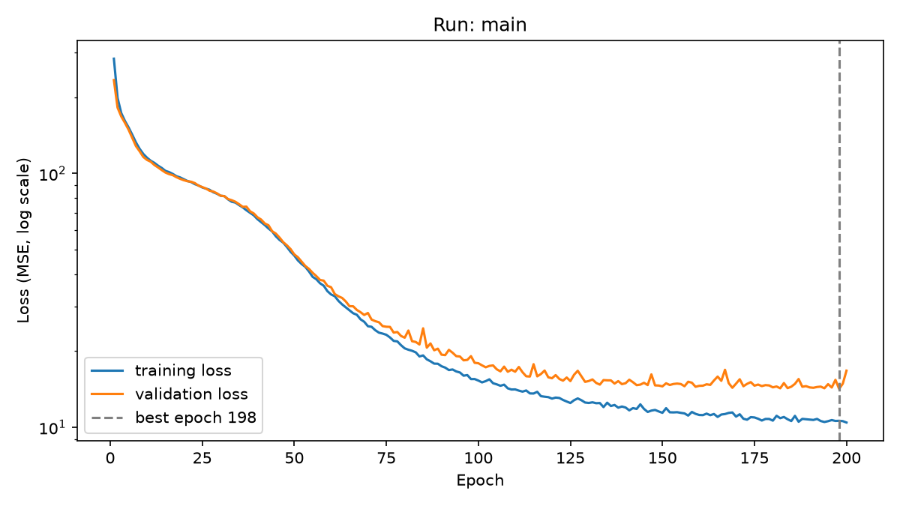
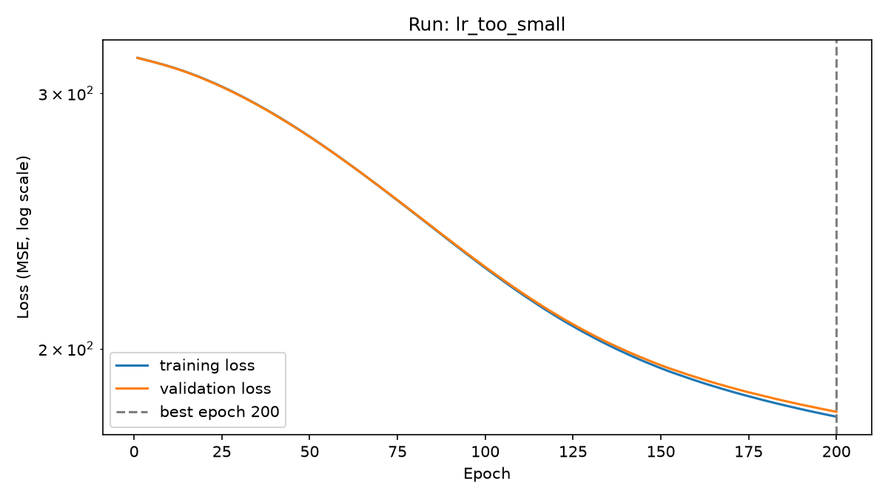
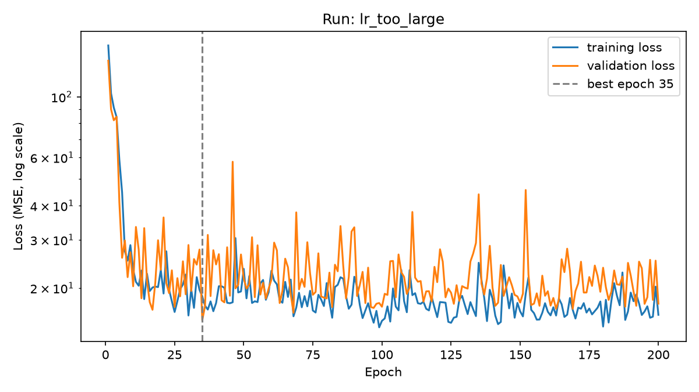
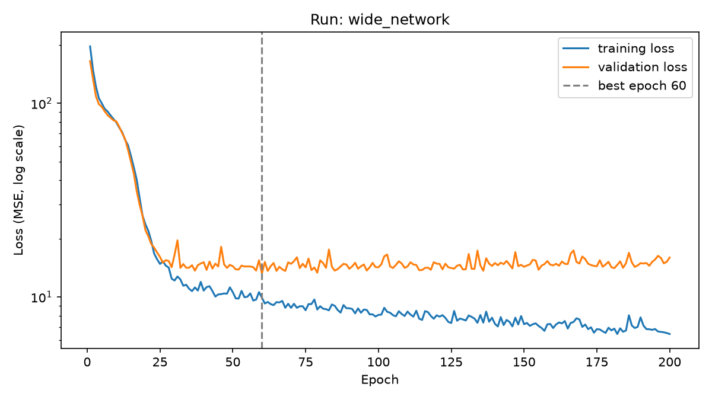

# Lakeshore Bike Demand

## What it does

This project predicts how many bikes will be rented from a station in the coming hour, using the hour of the day, the weather, whether it is a weekend and the type of station. It trains a small neural network with a training loop written by hand in PyTorch, and compares it honestly with two simple baselines: the training mean and a linear regression. The data are invented (made by `bikes_data.py`), so the results show how the method behaves, not how real stations behave.

## How to run it

```
conda env create -f environment.yml
conda activate lab07-first-principles
python train.py
python -m pytest
python -m ruff format --check .
python -m ruff check .
```

`python train.py` recreates everything in `reports/`: the learning curves, `history.csv`, `experiments.csv` and `metrics.json`.

## Data and split

`bikes_data.py` (given, never edited) builds 6,000 rows, one per station and hour, from a fixed seed, so everyone gets the same table. The table is split before any preparation into 3,600 training rows, 1,200 validation rows and 1,200 test rows (60%, 20%, 20%), with seed 2026.

The five numeric columns (hour, temperature, rain, wind, weekend) are standardized, and `station_type` is one-hot encoded into three columns. The scaler and the encoder are fitted on the training rows only, and then applied unchanged to the validation and test rows. Fitting them on all rows would let information from the validation and test rows leak into training. A test checks this: the training features average zero, and the validation features do not.

## Model and training

- **Network:** 8 inputs, two hidden layers of the same width with ReLU, and one output with no activation function, because the target is a count and not a probability.
- **Loss and optimizer:** mean squared error and the Adam optimizer. The learning curves show the MSE, and the MAE is reported in rentals.
- **Batches:** 64 rows per batch. Only the training loader shuffles.
- **Loop:** written by hand in `train.py`. It runs each epoch with `zero_grad()`, `backward()` and `step()`, logs the training loss, the validation loss and the validation MAE for every epoch, and puts back the weights of the epoch with the lowest validation loss.
- **Seeds:** the split, PyTorch and the training loader's random generator are all seeded with 2026, so `python train.py` gives identical numbers when it is run twice on the same computer. They may differ in the last digits on another computer.
- **Main run:** hidden width 64, learning rate 0.001, 200 epochs.

## Results

All scores are in bikes rented per station-hour (MAE) or squared bikes (MSE). The final network is the wide network (hidden width 512, learning rate 0.001, best epoch 60). I chose it from the validation scores alone, because it had the lowest validation MAE of the four runs (see Experiments). It was evaluated on the test rows once, at the end.

| Model | Validation MAE | Test MAE | Validation MSE | Test MSE |
|---|---|---|---|---|
| Training mean | 9.95 | 9.85 | 201.03 | 190.29 |
| Linear regression | 9.03 | 8.76 | 172.82 | 159.79 |
| Network (wide, 512) | 2.43 | 2.34 | 13.23 | 13.05 |

The network's test MAE of 2.34 rentals is about a quarter of the linear model's 8.76, and it is close to its validation MAE of 2.43, so the validation score was not too optimistic.

The linear model does badly because rentals do not move in a straight line with the hour. When I plotted rentals against the hour, the average had two peaks, one in the morning and one in the evening, with a dip at midday and low values at night, so a single straight line cannot follow it. The pattern also differs between station types and between weekdays and weekends, which a linear model cannot capture. It beats the training mean by less than one rental.



The curves show the main run (hidden width 64). The training loss and the validation loss fall together until about epoch 100, so the network is learning something that carries over to new rows. After about epoch 125 the validation loss stops improving and starts to jump around (14.5 at epoch 150, 16.7 at epoch 200), while the training loss keeps falling (10.4 at epoch 200). The gap that opens up is an early sign of overfitting, and the best epoch (198) is not a clean minimum.

## Experiments

The main run is hidden width 64, learning rate 0.001, batch size 64 and 200 epochs. Each other run changes one setting and keeps the rest the same. All four runs use seed 2026. The curves of each run are saved in `reports/`.

| Run | Change from main | Best epoch | Best validation MAE | Final training loss | Final validation loss |
|---|---|---|---|---|---|
| main | none | 198 | 2.605 | 10.447 | 16.721 |
| lr_too_small | learning rate 0.00001 | 200 | 9.135 | 179.529 | 180.930 |
| lr_too_large | learning rate 0.1 | 35 | 2.707 | 15.955 | 17.526 |
| wide_network | hidden width 512 | 60 | 2.427 | 6.433 | 15.972 |

**main (fine, with a small gap at the end).** Both losses fall together for about the first 100 epochs, and the validation MAE reaches 2.6, far below the baselines. After about epoch 125 the validation loss stops improving and becomes noisy, while the training loss keeps falling, so the gap (10.4 against 16.7) is a mild sign of overfitting. The network is not underfitting.



**lr_too_small (underfitting).** With a learning rate of 0.00001 the steps are tiny, so after 200 epochs the training loss (179.5) and the validation loss (180.9) are still close to where a network starts, and the validation MAE of 9.1 is no better than the linear baseline (9.03). The two losses stay together and are both high, which is the sign of underfitting. The best epoch is the last one, so the network was still improving and simply ran out of epochs.



**lr_too_large (unstable).** With a learning rate of 0.1 the network still learns, but the steps are too big. It reaches its best validation MAE (2.707) at epoch 35 and then does not improve. Its final training loss (16.0) is higher than the main run's (10.4), although it trained on the same rows for the same number of epochs, which fits steps that overshoot the minimum and keep bouncing around it. The curves are noisier than the main run's, and the result is worse.



**wide_network (overfitting, then rescued by early stopping).** A hidden width of 512 is far more than 3,600 training rows need. The training loss keeps falling (6.4 at epoch 200) while the validation loss reaches its lowest point at epoch 60 and then turns upward (16.0 at epoch 200). The gap between the two curves widening is the sign of overfitting. Because the loop puts back the weights of the best epoch, the final network is the epoch-60 one, and it has the lowest validation MAE of all four runs (2.427). That is why I chose it as the final network.

## Limitations

- **The data are invented.** They come from a formula plus random noise, not from real stations, so the numbers say nothing about real demand.
- **What the model cannot see.** It has no holidays, events, seasons, station locations, or how many bikes are available at a station. The only calendar information is the hour and whether it is a weekend.
- **It uses the weather of the same hour.** A planner would have to put in a weather forecast, and forecast errors would add to the model's errors.
- **It predicts an average, not the exact number.** The rentals are random counts, so even a perfect model cannot be exact for a single station-hour.
- **What a planner should not use it for.** Do not use it to decide where to move bikes in a real system, or for stations, seasons or weather that are very different from this table.